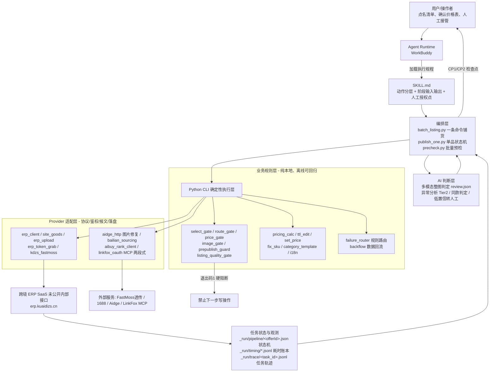
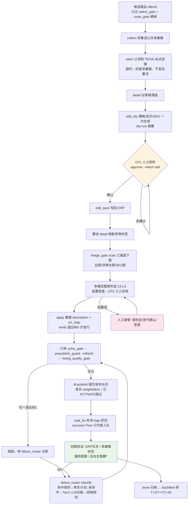
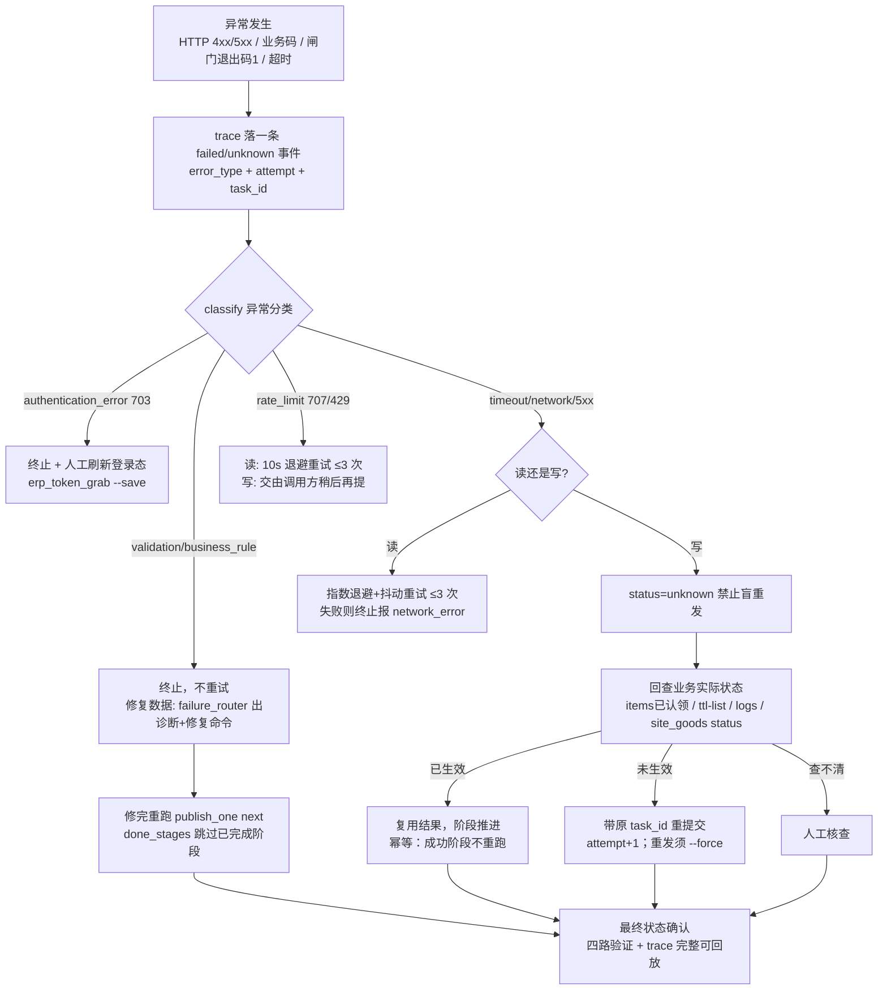

# 系统架构

> 本文件所有模块、命令、文件路径均对应仓库内真实代码（2026-11-27 核对）。
> 运行时规程的权威来源是 `SKILL.md`；本文只描述结构，不复述业务规则。

## 1. 系统总体架构

运行环境是 WorkBuddy（或任何支持 `SKILL.md` 的 Agent Runtime）。核心设计：**AI 判断与确定性程序执行分离**，两层只通过 CLI 参数契约耦合。

## 2. 核心模块职责

| 模块 | 真实载体 | 职责边界 |
|---|---|---|
| Agent Runtime | WorkBuddy 会话 | 任务理解、编排决策、多模态判定、异常分析（Tier2）；不直接触碰 HTTP 报文 |
| Skill Layer | `SKILL.md` + `references/` + `config/*.yaml` | Agent 执行规程：阶段顺序、输入输出、成功条件、人工授权点、错误码表；阈值全部外置 |
| Workflow / Orchestrator | `scripts/batch_listing.py`（波次级）、`scripts/publish_one.py`（单品状态机）、`scripts/precheck.py`（批量预检）、`scripts/publish_one.py` 内 `do_next` | 阶段推进、检查点闸、断点续跑、失败保状态 |
| AI Model | Runtime 内多模态模型 | 整图判定回填 `review.json`、低置信转人工、未路由失败的诊断；**不生成价格/类目等事实数据**（拿不到就留空） |
| Python CLI | `scripts/` 全部入口 | 确定性执行：闸门、定价、编辑、发布、回查、日志 |
| Business Rules | `select_gate` `price_gate` `image_gate` `prepublish_guard` `listing_quality_gate` `route_gate` `pricing_calc` `failure_router` | 校验/拦截/分类；只吃本地快照+config，不感知是哪个 ERP |
| ERP Client | `erp_client.py`（`_post` 统一入口：鉴权头、限流间隔、超时、写操作识别）+ `site_goods.py`（平台侧在售）+ `erp_upload.py`（OSS 直传） | 协议/鉴权/报文/落盘；换平台只重写这一层 |
| State Management | `erp_data/_run/pipeline/<offerId>.json`（阶段+approved+edit 参数+attempts）+ `tasklock.py`（fcntl 进程锁）+ `agentlog.set_current_task` | 断点恢复、幂等复用已完成阶段、并发互斥 |
| Logging / Observability | `timing.py`/`timing_report.py`（阶段耗时 JSONL）+ `agentlog.py`（任务轨迹 JSONL，task_id/event_id/attempt/error_type，写盘前统一脱敏） | 事后定位「哪个商品、哪一步、哪次尝试、什么错误、多久」 |
| Human Approval | `publish_one approve --which edit/images`（CP1/CP2）+ `batch_listing` 默认止步闸门 + `--publish` 显式开关 + 各写脚本 `--dry-run` 默认 | 授权与具体任务绑定、只放行一次、不落盘即不执行 |

## 3. 商品发布流程图

对应 `publish_one.py` 的 `STAGES`（13 阶段）与 `batch_listing.py` 的波次编排：

\* 第四路「TikTok 后台在售数」无接口，人工核验，文档中不得标 VERIFIED。

## 4. 异常恢复流程图

对应 `agentlog.classify` + `erp_client._post` 重试策略 + `failure_router`：

## 5. 可靠性机制落点（代码索引）

| 机制 | 实现位置 | 行为 |
|---|---|---|
| 幂等·写前查重 | `publish_one.stage_publish`（先查平台侧 ACTIVATE）、`cmd_start`（在售货源拒绝重复 start）、`stage_claim`（超时回查 items 已认领） | 不产生第二份草稿/重复认领 |
| 幂等·阶段复用 | `do_next` 的 `done_stages` + `stage` 指针 + `detail` 回跳修正 | 恢复时已成功阶段不重跑 |
| 超时集中配置 | `erp_client.HTTP_TIMEOUT`（默认 30s）、`site_goods.SITE_TIMEOUT`（180s）、`publish_one.run(timeout=240)`，均可 env 覆盖 | 无无限等待；连接/读取拆分受标准库限制，见 docs/security.md |
| 重试策略 | `erp_client._post`：写=单次机会；读=429/707/超时/网络/5xx 指数退避+抖动 ≤3 次 | 不对所有错误统一重试；703/业务码零重试 |
| 结果未知 | `status_unknown_write` → trace 记 `status:"unknown"` | 超时≠未执行，先回查（SKILL 硬纪律代码化） |
| 并发互斥 | `tasklock.py`（fcntl 独占锁），`do_next` 拿不到锁退出码 7 | 双进程不会互相覆盖 state |
| 断点续跑 | `erp_data/_run/pipeline/<offerId>.json` + `batch_listing --claimed` 续跑 | 进程中断后从当前 stage 恢复 |
| 任务轨迹 | `agentlog.py` JSONL（append-only，多进程安全）+ `timing.py` | task_id 可完整还原执行过程 |

已知边界（不夸大）：
- 人工授权不可无限期复用：`approve --which edit` 仅放行一次 `edit_save`，阶段推进后需重新确认；但「授权不跨任务复用」目前靠状态机 stage 指针保证，无独立签名机制。
- `wait` 阶段轮询到 `processing` 超时后任务停在原阶段，需人工决定继续 `next` 还是介入——未自动升级 unknown。
- 文件锁只覆盖 `publish_one.do_next` 入口；直接手打单条 `erp_client ttl-claim` 不经过锁（历史遗留用法，纪律上应避免）。
